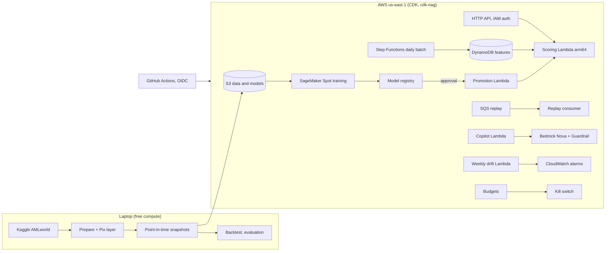

<p align="center">
  
</p>

<!-- Rendered from docs/templates/root/README.md by `muletrace docs render`.
     Every number below is a placeholder resolved against docs/generated/*.yaml and
     configs/calibration/*.yaml; a test fails if this file and its template drift apart. -->

# MuleTrace

**Receive-side mule-account defence for instant payments:** a daily, point-in-time graph risk
score for receiving accounts, a fund-flow tracer inspired by Brazil's MED 2.0, and an
investigation copilot whose case files are checked fact by fact before an analyst sees them,
with the production path on AWS.

MuleTrace is a portfolio project built end to end by one person on **synthetic data** (IBM
AMLworld plus a simulated Pix layer). It is not used by any bank or payment provider, and it does
not process real Pix data. What it tries to show is the judgement a senior data scientist brings
to a fraud problem: start from the decision an analyst makes and its budget, make the
validation honest about time and labels, measure everything that is published, and say plainly
what did not work.

[Case explorer (static demo)](demo/) ·
[Evaluation report](docs/eval_report.md) ·
[Model card](docs/model_card.md) ·
[Business case](docs/business_case.md) ·
[Decisions (ADRs)](docs/adr/README.md)

## Results at a glance

HI-Small temporal hold-out (7 to 9 September 2022), **20 alerts per 10,000 scored accounts**,
95% intervals from a paired bootstrap:

| | Recall (95% CI) | Precision | Average precision |
|---|---:|---:|---:|
| Rules, tuned on training days | {{ backtest_HI-Small.bootstrap.recall.rules_tuned.estimate | pct }} ({{ backtest_HI-Small.bootstrap.recall.rules_tuned.ci95 | ci }}) | {{ backtest_HI-Small.hold_out.rules_tuned[alerts_per_10k=20].precision | pct }} | {{ backtest_HI-Small.bootstrap.average_precision.rules_tuned.estimate | f3 }} |
| LightGBM, behaviour features | {{ backtest_HI-Small.bootstrap.recall.lgbm_tabular.estimate | pct }} ({{ backtest_HI-Small.bootstrap.recall.lgbm_tabular.ci95 | ci }}) | {{ backtest_HI-Small.hold_out.lgbm_tabular[alerts_per_10k=20].precision | pct }} | {{ backtest_HI-Small.bootstrap.average_precision.lgbm_tabular.estimate | f3 }} |
| **LightGBM, behaviour + graph** | **{{ backtest_HI-Small.bootstrap.recall.lgbm_tabular_graph.estimate | pct }}** ({{ backtest_HI-Small.bootstrap.recall.lgbm_tabular_graph.ci95 | ci }}) | {{ backtest_HI-Small.hold_out.lgbm_tabular_graph[alerts_per_10k=20].precision | pct }} | {{ backtest_HI-Small.bootstrap.average_precision.lgbm_tabular_graph.estimate | f3 }} |

- Graph features raise recall by {{ backtest_HI-Small.bootstrap.recall_difference.lgbm_tabular_graph minus lgbm_tabular.estimate | pct }} in absolute terms
  ({{ backtest_HI-Small.bootstrap.recall_difference.lgbm_tabular_graph minus lgbm_tabular.ci95 | ci }}) on HI-Small; on LI-Small,
  with fewer mules, the graph model reaches {{ backtest_LI-Small.bootstrap.recall.lgbm_tabular_graph.estimate | pct }} recall and its gain over
  behaviour features is not distinguishable from zero.
- **What failed:** the score finds mules that are already active
  ({{ backtest_HI-Small.slices_lgbm_tabular_graph.activity.already active at as-of.recall | pct }} recall) and almost never those that are not yet
  ({{ backtest_HI-Small.slices_lgbm_tabular_graph.activity.not yet active.recall | pct }}). Alerted accounts receive only
  {{ backtest_HI-Small.hold_out.lgbm_tabular_graph[alerts_per_10k=20].value_share | pct }} of the simulated illicit inflow, which is why the tracer exists.
- The deterministic fact checker rejected every perturbed draft in the copilot evaluation, and no
  unsupported claim reached the analyst. **The language-model copilots have not been evaluated
  yet**: Bedrock access is pending, so only the model-free baseline is measured.

## 1. The problem in numbers

From the Banco Central do Brasil open-data service (MED statistics, October 2025 to September
2026, accessed {{ bcb_public_figures.accessed_on }}):

| | |
|---|---:|
| Pix transfers disputed through MED (the special return mechanism) | {{ bcb_public_figures.med_disputes.disputes_filed | int }} |
| Disputes accepted | {{ bcb_public_figures.med_disputes.disputes_accepted | int }} |
| Value of accepted disputes | R$ {{ bcb_public_figures.med_disputes.accepted_value_brl | billions }} billion |
| Share of that value actually returned | {{ bcb_public_figures.med_disputes.returned_value_share | pct }} |
| Share not returned because the account no longer had the balance | {{ bcb_public_figures.med_disputes.not_returned_insufficient_balance_value_share | pct }} |

By the time a dispute arrives, the money has usually left the first account. A receiving
provider wins only by acting on mule-like accounts *before* the dispute, and by following the
money when one arrives. Amazon Fraud Detector, a managed option for this kind of scoring, has
been closed to new customers since 7 November 2025; MuleTrace is an open alternative built from
general-purpose services. Sources and assumptions: [business case](docs/business_case.md).

## 2. The decision it supports

| Problem | Decision | Action | Evidence MuleTrace provides |
|---|---|---|---|
| Mules receive and forward money before any dispute | Which accounts to review today, within a fixed budget | Review; a person may place a precautionary hold | Calibrated daily score with reason codes |
| The first account is often empty when a dispute arrives | Which onward accounts to contact | Notify next-hop institutions | Hop-by-hop trace with recoverable balances |
| Analysts rebuild evidence by hand | Whether the evidence supports hold, monitor or close | Approve, edit or reject a draft | Case file whose every claim cites a transfer, checked by code |
| Behaviour drifts; demos run up bills | Retrain or roll back; keep running or stop | Follow the runbook; trip the kill switch | Drift report and alarms; budgets and kill switch |

MuleTrace never acts on its own. Impact is measured in review units (a false positive costs one
review; a missed mule costs 10 to 500), never in money saved. Full map:
[docs/decision_map.md](docs/decision_map.md).

## 3. Architecture



Plain Python on Lambda, no always-on endpoints, everything tagged, every stack nag-checked in CI.
Decisions and their reasons: [ADR-002](docs/adr/002-region-and-services.md) (services),
[ADR-003](docs/adr/003-no-agentcore-in-v1.md) (no AgentCore),
[ADR-009](docs/adr/009-serving-and-parity.md) (serving).

## 4. Data

- **IBM AMLworld** HI-Small ({{ data_profile.HI-Small.transactions | int }} transactions, one laundering transaction in
  {{ data_profile.HI-Small.one_laundering_per_n_transactions | int }}) and LI-Small ({{ data_profile.LI-Small.transactions | int }}, one in
  {{ data_profile.LI-Small.one_laundering_per_n_transactions | int }}), from Altman et al., arXiv:2306.16424. Licence
  CDLA-Sharing-1.0, verified on the Kaggle metadata; files are downloaded, never re-published,
  and pinned by SHA-256.
- **The Pix layer** is this project's simulator: instant-transfer re-labelling in reals, Pix keys,
  DICT-style markings, MED-style disputes and free-text descriptions, calibrated only to public
  BCB aggregates. Its dataset card is ready for publication under CDLA-Sharing-1.0
  ([card](docs/pix_layer_dataset_card.md)).
- Limitations: synthetic laundering follows known rules; ten days of data; AMLworld amounts are
  far larger than Brazilian scam transfers, so every monetary figure is synthetic.
  [Data card](docs/data_card.md).

## 5. Method

- **Target:** an account is positive at as-of time *t* if it is confirmed as a mule in
  (*t*, *t* + 48 h]; confirmation arrives 24 hours after its first illicit inflow
  ([ADR-006](docs/adr/006-target-and-validation-design.md)).
- **Leakage controls:** every feature uses only transactions strictly before *t*; neighbour labels
  count only if confirmed before *t*; training labels are truncated at the test time. Property
  tests generate random transaction tables and check that nothing after *t* can change a feature.
- **Features:** flows over 24 hours, 72 hours and 7 days, forwarding speed, structuring signals,
  and graph features (degrees, PageRank, sender aggregates, confirmed-mule neighbours)
  ([ADR-007](docs/adr/007-graph-features.md)).
- **Model ladder:** hand-set rules, rules tuned on training days, LightGBM on behaviour features,
  LightGBM with graph features; isotonic calibration; SHAP reason codes.
- **Validation:** rolling origin with four folds, a pooled three-day hold-out, a paired Poisson
  bootstrap, recall at fixed alert budgets, expected cost in review units, a label-delay sweep
  and AMLworld's own transaction-level task as an external check.

## 6. Results

| | HI-Small | LI-Small |
|---|---:|---:|
| Recall at 20 per 10,000, graph model | {{ backtest_HI-Small.bootstrap.recall.lgbm_tabular_graph.estimate | pct }} ({{ backtest_HI-Small.bootstrap.recall.lgbm_tabular_graph.ci95 | ci }}) | {{ backtest_LI-Small.bootstrap.recall.lgbm_tabular_graph.estimate | pct }} ({{ backtest_LI-Small.bootstrap.recall.lgbm_tabular_graph.ci95 | ci }}) |
| Average precision, graph model | {{ backtest_HI-Small.bootstrap.average_precision.lgbm_tabular_graph.estimate | f3 }} | {{ backtest_LI-Small.bootstrap.average_precision.lgbm_tabular_graph.estimate | f3 }} |
| Recall at 20 per 10,000, tuned rules | {{ backtest_HI-Small.bootstrap.recall.rules_tuned.estimate | pct }} | {{ backtest_LI-Small.bootstrap.recall.rules_tuned.estimate | pct }} |
| Transaction-level F1, external check (paper: GIN / GFP + LightGBM) | {{ transaction_level_check.HI-Small.test.f1_percent | f2 }}% ({{ transaction_level_check.HI-Small.paper_reference.GIN | f2 }}% / {{ transaction_level_check.HI-Small.paper_reference.GFP + LightGBM | f2 }}%) | {{ transaction_level_check.LI-Small.test.f1_percent | f2 }}% ({{ transaction_level_check.LI-Small.paper_reference.GIN | f2 }}% / {{ transaction_level_check.LI-Small.paper_reference.GFP + LightGBM | f2 }}%) |

- **Label delay matters, in a counter-intuitive way.** With no confirmation delay, recall at the
  budget falls to {{ delay_sweep_HI-Small.delays.0h.recall.lgbm_tabular_graph.estimate | pct }}; at 48 hours it is
  {{ delay_sweep_HI-Small.delays.48h.recall.lgbm_tabular_graph.estimate | pct }}. The slower confirmations are, the more a daily score is worth.
- **Tuning the rules did not help**, and on LI-Small it made them worse on the hold-out.
- **Calibration** saturates at 1.0 at the very top of the score range, so displayed
  probabilities are capped at 0.99.
- **Fund-flow tracer:** of {{ tracer_evaluation_HI-Small.disputes_traced | int }} simulated accepted disputes on HI-Small, the money had moved on
  in {{ tracer_evaluation_HI-Small.disputes_with_onward_hops | int }}; where it had, the median dispute had
  {{ tracer_evaluation_HI-Small.median_with_onward_hops.beyond_first_account_share | pct }} of its value beyond the first account. The tracer's
  pessimistic allocation rule has low precision against AMLworld's labels
  ({{ tracer_evaluation_HI-Small.median_with_onward_hops.precision_usd | pct }} median); ADR-010 explains the trade-off.
- **Drift:** across the hold-out the score's PSI stayed at or below
  {{ drift_HI-Small.days.2022-09-09.score.psi | f4 }}; account age drifted by construction, which exposed a real limitation (it is
  measured from the start of the data, not from account opening).

Everything, with every slice and interval: [docs/eval_report.md](docs/eval_report.md).

## 7. Investigation copilot

Three agents on the Bedrock Converse API (evidence, typology, report) draft a structured case
file in which every claim lists the transfers, amounts, dates and accounts it relies on. A
deterministic fact checker compares each of them with the evidence and blocks the draft on any
mismatch, on an unknown typology, action or policy, on a recommendation to release funds and on
contact details. A Bedrock Guardrail adds prompt-attack filtering and output masking; it cannot
see tool results, so the checker, not the guardrail, is the gate
([ADR-011](docs/adr/011-copilot-grounding-and-guardrails.md)).

| Template baseline on {{ copilot_eval_template_HI-Small.metrics.cases | int }} gold cases | Value |
|---|---:|
| Unsupported claims reaching the analyst | {{ copilot_eval_template_HI-Small.metrics.unsupported_claims_reaching_analyst | int }} |
| Perturbed drafts rejected: invented transfer / wrong amount / wrong date / contact details / release funds | {{ copilot_eval_template_HI-Small.checker_strictness.invented_transaction.rejection_rate | pct }} / {{ copilot_eval_template_HI-Small.checker_strictness.wrong_amount.rejection_rate | pct }} / {{ copilot_eval_template_HI-Small.checker_strictness.wrong_date.rejection_rate | pct }} / {{ copilot_eval_template_HI-Small.checker_strictness.pii_in_summary.rejection_rate | pct }} / {{ copilot_eval_template_HI-Small.checker_strictness.release_recommended.rejection_rate | pct }} |
| Action agreement | {{ copilot_eval_template_HI-Small.metrics.action_agreement | pct }} |
| Typology accuracy | {{ copilot_eval_template_HI-Small.metrics.typology_accuracy | pct }} |

**What failed or is missing:** the template's typology accuracy is low (one account's flow shape
rarely identifies a typology); the single-call and multi-agent copilots, their cost, latency and
injection resistance, and the LLM judge are **not measured yet** (Bedrock access and human labels
are owner actions). The harness, gold set, adversarial suite and release gate are ready
(`.github/workflows/evals.yml`).

## 8. Production: deploy, monitor, retrain, roll back, tear down

- **Deploy:** `make deploy` or the manual `deploy` workflow (GitHub OIDC, no stored keys,
  reviewer approval for production). Seven stacks: storage, serving, training, pipeline, agents,
  monitoring, cost guards.
- **Promote:** approving a package in the SageMaker model registry triggers the promotion Lambda.
- **Monitor:** weekly drift job (PSI and KS) with CloudWatch alarms.
- **Retrain and roll back:** documented in the [runbook](docs/runbook.md); rollback is a
  re-approval of the previous version.
- **Stop:** budget alerts at US$15, the kill switch at 100% of it, a deny policy on the
  deployment role at US$20, anomaly detection.
- **Tear down:** `make teardown`.

Nothing has been deployed yet: the AWS account setup is an owner action, so every figure about
the deployed system below is marked as derived or not measured.

## 9. Cost and performance

| Measure | Value | Status |
|---|---:|---|
| Cloud cost to date | US$0 | Measured (nothing deployed) |
| Scoring latency, in-process p50 / p99 | {{ serving_benchmark.latency_ms.p50 | f2 }} / {{ serving_benchmark.latency_ms.p99 | f2 }} ms | Measured locally |
| Model artefact | {{ serving_benchmark.artifact_bytes | int }} bytes, loads in {{ serving_benchmark.artifact_load_ms | f2 }} ms | Measured locally |
| Cost per 1,000 scores | about US$0.0013 plus US$0.0000133 per billed millisecond | Derived from published prices |
| Copilot model cost per case, upper bound | US$0.0048 | Derived from the token budget |
| Deployed latency, cold start, cost per copilot case | — | Not measured yet |

Details and sources: [docs/cost.md](docs/cost.md), [docs/performance.md](docs/performance.md).

## 10. How to run

Requirements: Python 3.12 and [uv](https://docs.astral.sh/uv/); a Kaggle API token for the data;
for the cloud part, an AWS account, Node.js and Docker.

```bash
uv sync --all-extras --all-groups      # environment from uv.lock
make all                               # download → prepare → features → backtest → model → reports
make check                             # every quality gate CI runs
uv run muletrace --help                # every command
python -m http.server --directory demo # the case explorer, on http://localhost:8000
```

Measured on a 6-core laptop: data preparation for both datasets takes seconds, a feature build
about half a minute per dataset, the LI-Small backtest about 14 minutes and the label-delay sweep
about 20 minutes ([docs/performance.md](docs/performance.md)).

## 11. Tests and quality gates

pytest with branch coverage (at least 85%, enforced) and Hypothesis property tests for look-ahead,
label delay, encoding and tracer conservation; ruff, mypy `--strict`, xenon complexity limits,
vulture, deptry, bandit, pip-audit, gitleaks, cdk-nag, Trivy on the image, a test that fails if a
published number drifts from its source, and a commit-message check on authorship. Weekly audits:
[docs/audits](docs/audits).

## 12. Limitations, risks and the next two weeks

- Synthetic data, ten days, one seed per model; no fairness analysis is possible on AMLworld.
- Account age is measured from the start of the data; a real system must use the opening date.
- The copilot's language-model results, deployed latency and cloud cost are not measured yet.
- Risks and controls: [docs/threat_model.md](docs/threat_model.md).

With two more weeks: run the Bedrock evaluation and calibrate the judge with human labels;
deploy, measure latency and cost, and test the kill switch on purpose; try a pro-rata allocation
rule in the tracer; replace window aggregates with richer graph-pattern features to close the gap
to GFP + LightGBM.

## 13. Licences and authorship

- Code: Apache-2.0 ([LICENSE](LICENSE), [NOTICE](NOTICE)).
- Data derived from IBM AMLworld (the Pix layer, the gold cases, the demo cases):
  CDLA-Sharing-1.0 ([data/LICENSES](data/LICENSES)). Credit: Altman et al., IBM Research.
- Brazilian regulatory figures: Banco Central do Brasil open data, cited with dates. No Pix or BCB
  visual identity is used. "Inspired by MED 2.0" means exactly that: MuleTrace does not
  implement MED and is not BCB-compliant software.
- Author: **Renan Pinheiro**, sole author of the code, the analysis and the documents.
